

<picture>
  <source media="(prefers-color-scheme: dark)" srcset="assets/mPDF-icon-dark.svg">
  
</picture>

# mPDF

**A fast, distraction-free PDF reader and editor for Mac and Windows.**

Read, annotate, edit text and images, organize pages, fill and sign forms —
on the page itself, with the tools out of sight until you reach for them.
Coming soon to iPhone and iPad.

**[Download the latest release](https://github.com/tacshi/mPDF-Release/releases/latest)**

 

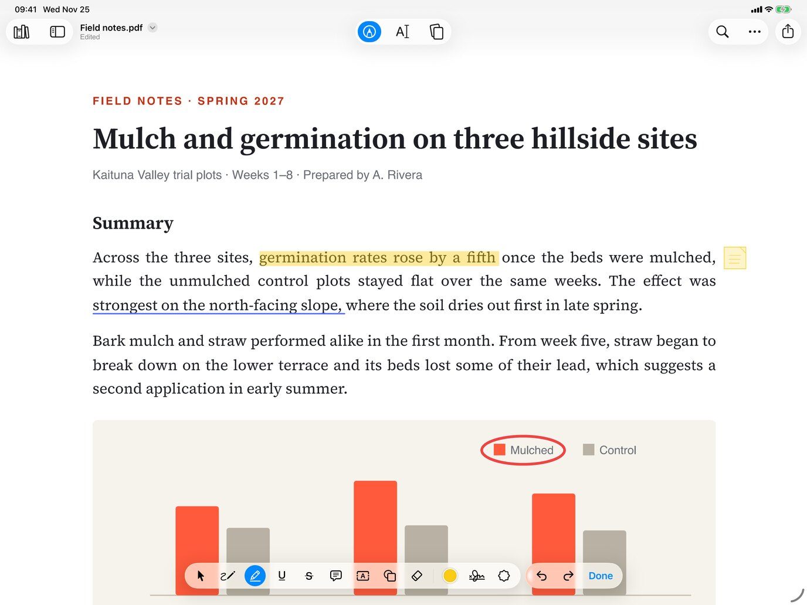

Markup on iPad. More screenshots [below](#screenshots).

## Install

Download the file for your computer from the
[latest release](https://github.com/tacshi/mPDF-Release/releases/latest):

| File | For |
| --- | --- |
| `mPDF-<version>-arm64.dmg` | Apple Silicon Macs (M-series) |
| `mPDF-<version>-amd64.dmg` | Intel Macs |
| `mPDF-<version>-universal.dmg` | Any Mac (larger download) |
| `mPDF-<version>-windows-x64-setup.exe` | Windows installer |
| `mPDF-<version>-windows-x64.zip` | Windows, portable (no install) |

mPDF checks for newer versions automatically (you can turn this off in
Settings).

### Mac

1. Download the DMG for your Mac. Not sure which Mac you have? Apple menu →
   **About This Mac**: a "Chip" line means Apple Silicon, a "Processor" line
   means Intel.
2. Open it and drag **mPDF** into **Applications**.
3. Launch mPDF from Applications.

**Requirements:** macOS 13 Ventura or later. Every Mac build is signed and
notarized by Apple.

### Windows

1. Download and run `mPDF-<version>-windows-x64-setup.exe`.
2. The installer sets mPDF up for your account only, so it asks for no
   administrator rights. It can also add mPDF to the apps that open PDF files.
3. Launch mPDF from the Start menu.

The Windows packages are not code-signed yet, so SmartScreen may say "Windows
protected your PC" the first time. Choose **More info** → **Run anyway**.

For the portable ZIP, extract it anywhere and run `mpdf.exe`. To open PDFs
with it, run `Register-mPDF.ps1` from the same folder.

**Requirements:** Windows 10 or later, 64-bit.

### iPhone and iPad

mPDF for iPhone and iPad is coming to the App Store (iOS and iPadOS 26 or
later).

## Highlights

- **Reader-first design** — immersive reading with chrome that steps aside,
  tabs that come back where you left off, thumbnails, bookmarks, full-text
  search, single or two-page layout, and normal, sepia or night page
  appearance
- **True content editing** — edit existing text and images in place, find and
  replace text
- **Annotations** — highlights, underlines, strike-outs, notes, free text,
  pen, shapes and arrows, with full undo and redo
- **Page organizer** — reorder, rotate, duplicate, insert (blank pages,
  other PDFs, images, the clipboard), replace, extract, and split by page
  count, size or bookmarks
- **Forms and signatures** — fill forms, sign with a drawn signature, and
  reuse your own stamps; on Mac, iPhone and iPad, also sign with a
  certificate and validate digital signatures
- **Privacy tools** — find & redact (redacted content is removed from the
  saved file), remove hidden text, strip web links, add or remove password
  protection
- **Housekeeping** — reduce file size, attachments and links panels, print
- **Publications** — import Adobe Digital Editions (ACSM) and LCP
  publications on Mac and Windows
- **Command line** — an `mpdf` tool to split, rotate, compress, fill forms,
  encrypt and verify signatures from a terminal (on a Mac, install it from
  the **Tools** menu; `mpdf help` lists every command)
- **No account, no cloud** — mPDF works on your files where they are and
  collects no data

### On iPhone and iPad

- Liquid Glass bars that float over the page and hide while you read
- Apple Pencil ink with pressure, hover previews, double-tap and squeeze
- Scan paper documents into PDF pages with the camera
- Several windows side by side on iPad, with the iPad menu bar and keyboard
  shortcuts
- Built for iPhone Duo: the layout follows the device as it folds and
  unfolds

## Screenshots

<table>
  <tr>
    <td width="50%">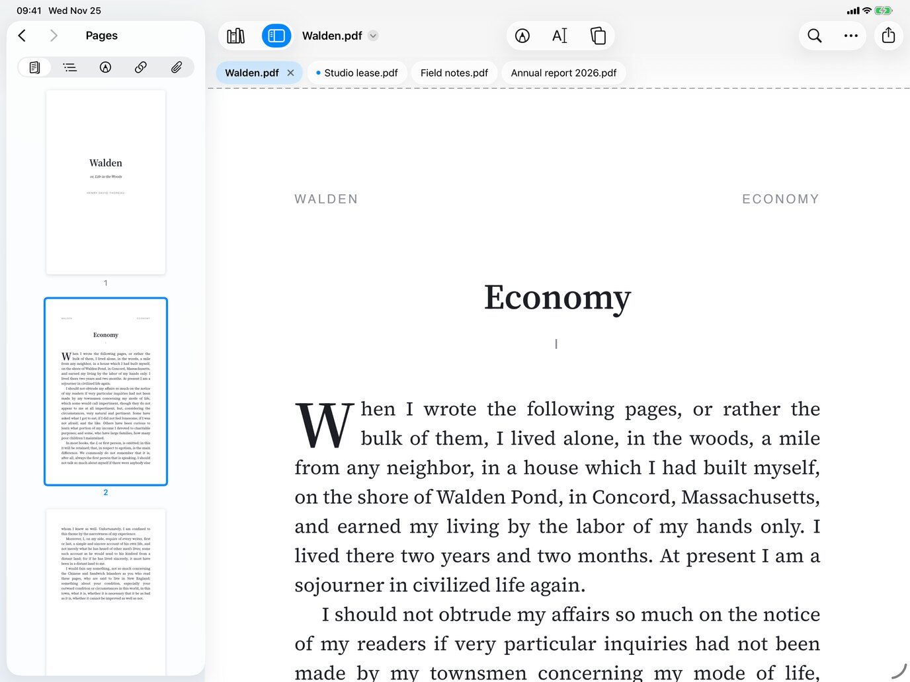</td>
    <td width="50%">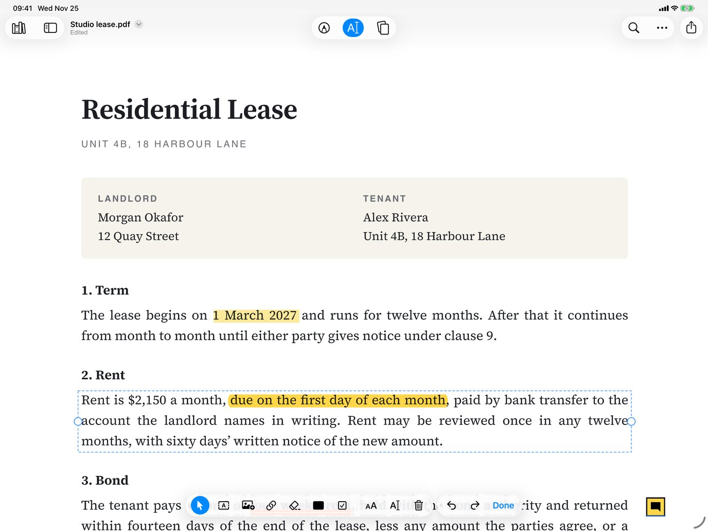</td>
  </tr>
  <tr>
    <td align="center">Read with thumbnails and tabs</td>
    <td align="center">Edit the text itself</td>
  </tr>
  <tr>
    <td width="50%"></td>
    <td width="50%">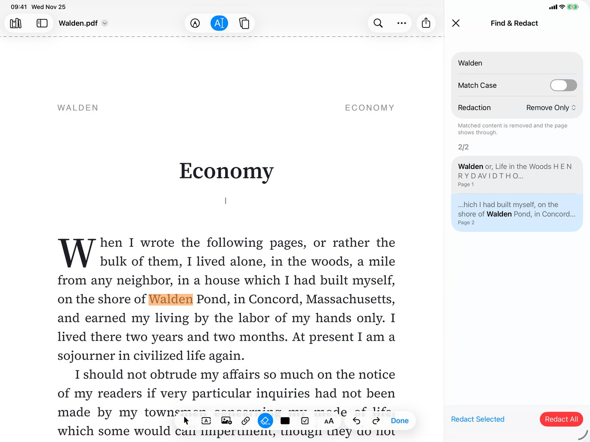</td>
  </tr>
  <tr>
    <td align="center">Mark up</td>
    <td align="center">Find and redact</td>
  </tr>
</table>

<table>
  <tr>
    <td width="25%">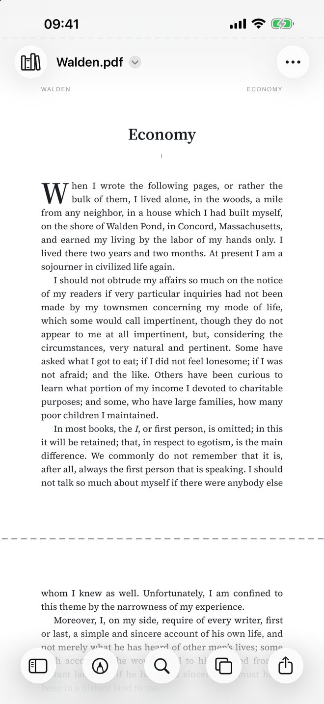</td>
    <td width="25%">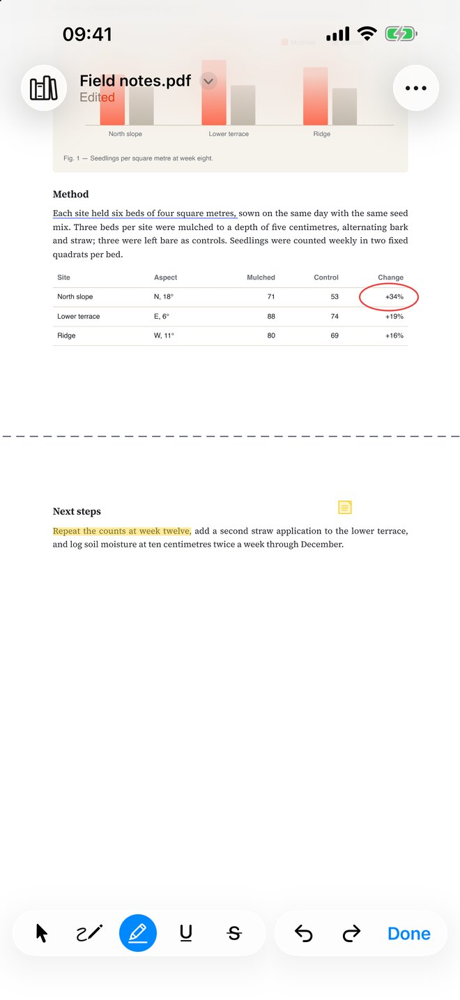</td>
    <td width="25%">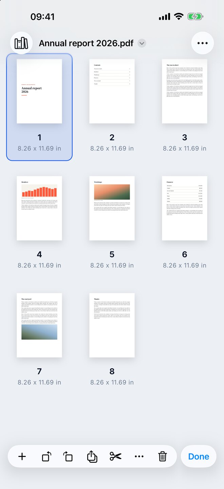</td>
    <td width="25%">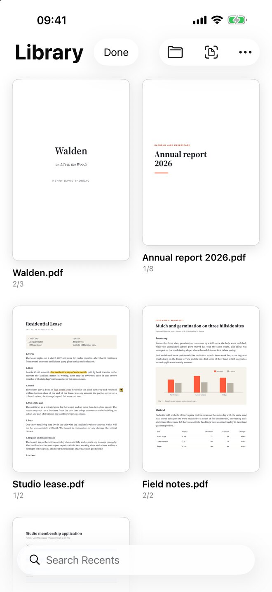</td>
  </tr>
  <tr>
    <td align="center">Read</td>
    <td align="center">Mark up</td>
    <td align="center">Organize pages</td>
    <td align="center">Library</td>
  </tr>
</table>

<table>
  <tr>
    <td width="33%">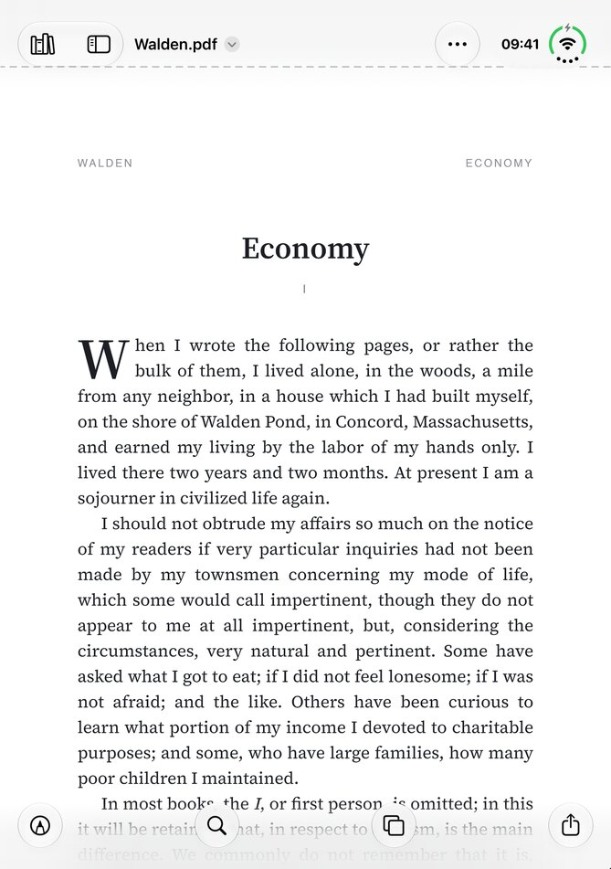</td>
    <td width="33%">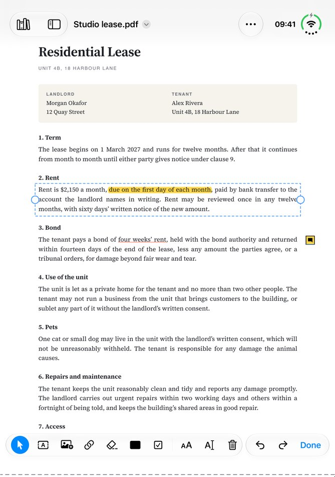</td>
    <td width="33%">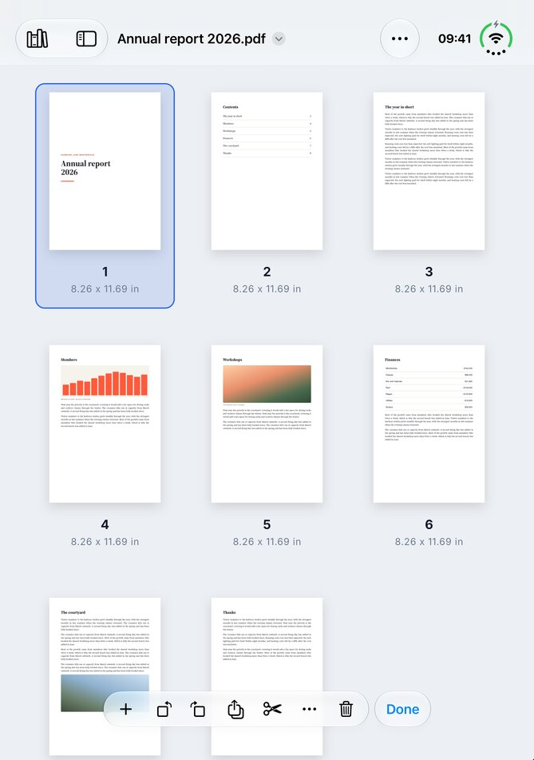</td>
  </tr>
  <tr>
    <td colspan="3" align="center">iPhone Duo, unfolded</td>
  </tr>
</table>

## Feedback

Found a bug or have a suggestion? Please
[open an issue](https://github.com/tacshi/mPDF-Release/issues).

When reporting a bug, it helps to include:

- The mPDF version (mPDF → About mPDF on a Mac, or the file name you
  downloaded)
- Your system: macOS version and Apple Silicon or Intel, or your Windows
  version
- Steps to reproduce, and a sample PDF if the issue is file-specific
  (only share files you're comfortable making public)

---

© 2026 NovaOtter. Mac builds are signed and notarized by Apple.

